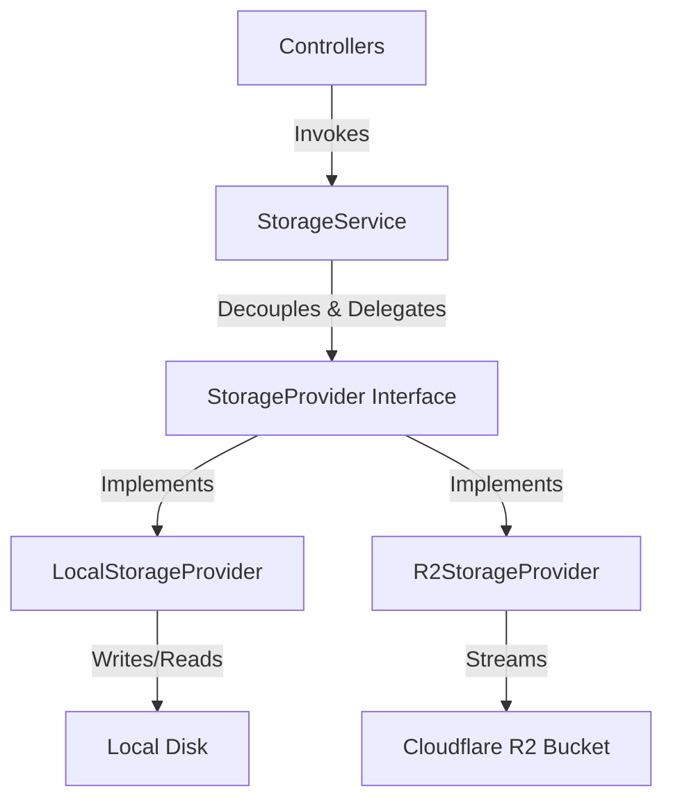

# Storage Provider Architecture & Refactoring Report

This document details the refactoring of PhotoCollect's storage architecture from a monolithic concrete implementation to a modular, provider-agnostic system.

---

## 1. Architecture Overview
Prior to this sprint, the image processing and storage routines were direct dependencies in controllers and services. In this sprint, we successfully decoupled all file operations using the **Provider Pattern**:

*   **Controllers** depend exclusively on the generic `StorageService`.
*   `StorageService` handles environment selection (`local` vs `r2`), delegations, JSON-structured logging, and custom exception mapping.
*   **Providers** implement the generic `StorageProvider` interface, wrapping the actual engine-specific API calls.



---

## 2. Folder Structure
The storage logic is organized in the following namespace:
```text
server/
├── docs/
│   ├── r2-test.md
│   └── storage-architecture.md         # (New) Architecture Doc
├── storage/                            # (New) Core Storage Folder
│   ├── StorageProvider.js              # (New) Base Provider Contract
│   ├── StorageService.js               # (New) Service Wrapper/Delegator
│   ├── errors.js                       # (New) Custom Storage Errors
│   └── providers/                      # (New) Concrete Providers
│       ├── LocalStorageProvider.js     # (New) Local Filesystem Provider
│       └── R2StorageProvider.js        # (New) Cloudflare R2 Provider
└── services/
    └── storageService.js               # Modified helper routing (Backward compatibility layer)
```

---

## 3. Storage Interface Design
The `StorageProvider` base contract exposes the following core methods:

*   `storePhoto(file, req)`: Handles thumbnail processing (Sharp), URL building, and storage writes. Returns `{ filename, originalUrl, thumbnailUrl, storageProvider }`.
*   `deletePhoto(filename)`: Removes both the original and thumbnail assets.
*   `getFileStream(filename, type)`: Returns a readable data stream of the requested asset.

---

## 4. Error Handling Improvements
Custom structured errors are introduced in `server/storage/errors.js`:
*   `StorageError`: Base storage exception class.
*   `StorageUnavailableError`: Used when the active provider is offline or uninitialized.
*   `UploadFailedError`: Used when writes fail.
*   `DeleteFailedError`: Used when unlinks fail.
*   `FileNotFoundError`: Used when file stream targets do not exist.
*   `ProviderConfigurationError`: Used when environment credentials are invalid/missing.

Low-level engine errors (e.g. AWS SDK exceptions or Node `ENOENT` filesystem exceptions) are caught inside the concrete provider and translated to these application-level errors before bubbling up.

---

## 5. Logging Improvements
Structured JSON logging is fully integrated inside `StorageService`:
*   Logs are output as structured JSON objects containing `level`, `message`, `provider`, `filename`, `sizeBytes`, `durationMs`, and `timestamp`.
*   Enables standard ingestion by production log aggregation tools (e.g., Datadog, ELK, AWS CloudWatch).
*   Guarantees that sensitive credentials or secrets are never logged.

---

## 6. Rollback & Fallback Verification
*   **Verification:** Reverting the active provider to local storage requires only setting `STORAGE_PROVIDER=local` in the environment.
*   **Hybrid Read Fallback:** Both `deletePhoto` and `getFileStream` support an optional third parameter: `specificProvider`. Since existing database records store their original `storageProvider` value, the service will load or delete old local files even if the active provider is swapped to `r2`, preventing broken image displays during migration windows.
